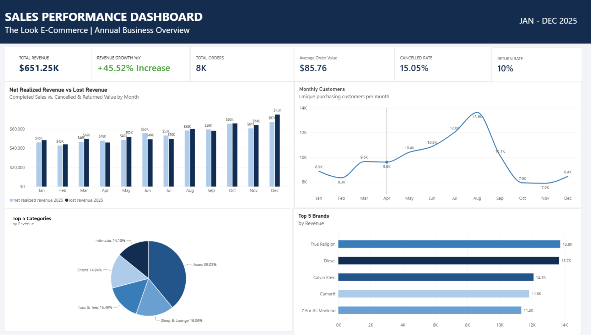
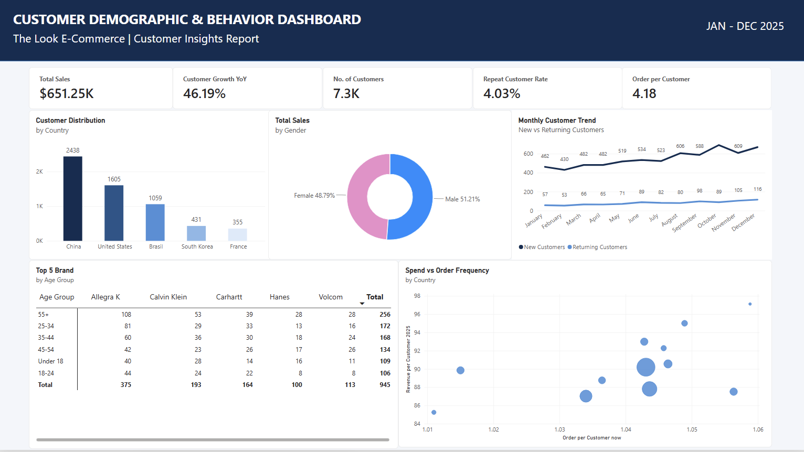

# TheLook E-commerce Dashboard (2025)
Two-page Power BI report covering **Sales Performance** and **Customer Demographic & Behavior** for 2025 based on the TheLook e-commerce dataset.
## Cleanded Dataset
You can access the cleaned dataset here: [TheLook Sales Dataset](Sales_data.xlsx)
## Dashboard Preview
### Sales Performance (2025)

### Customer Demographic & Behavior (2025)

## 2025 KPI (Completed Orders)
- **Total Revenue:** $651,250
- **Revenue Growth YoY:** 45.52% Increase
- **Lost Revenue (Cancelled & Return):** $661,030
- **Total Orders:** 8000
- **Average Order Value:** $85,76
- **Cancelled Rate:** 15,05%
- **Returned Rate:** 10%
- **Unique Customers:** 73000
- **Order per Customer:** 1,04
- **Customer Growth YoY:** 46,19%
## DAX Measures and Metric
You can access the DAX formulas here: [Dax Measures](dax.measures.md)
